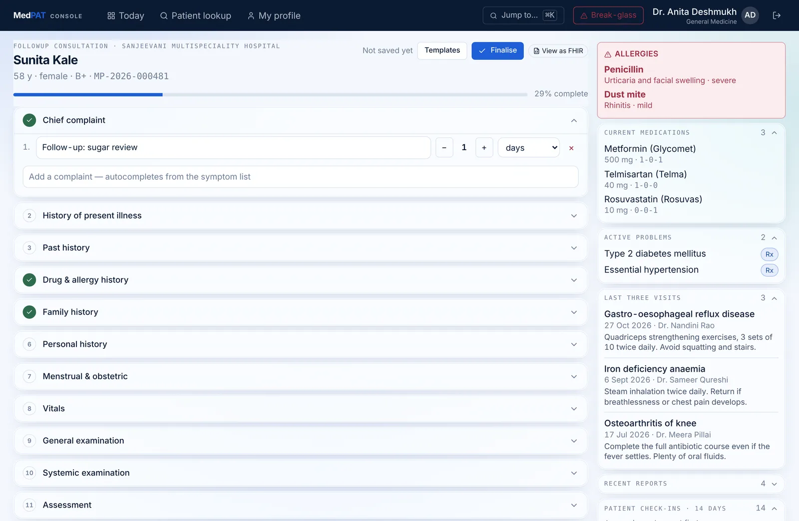
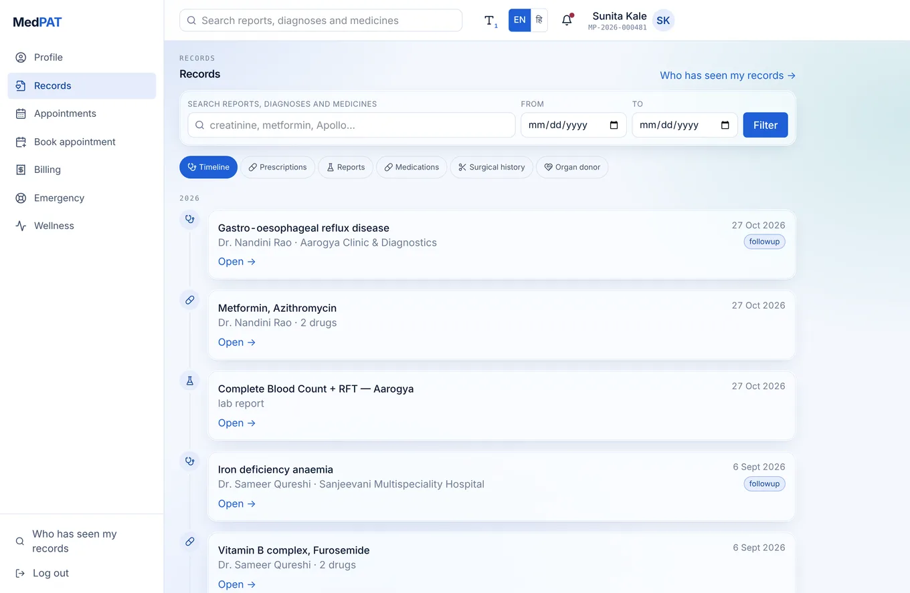
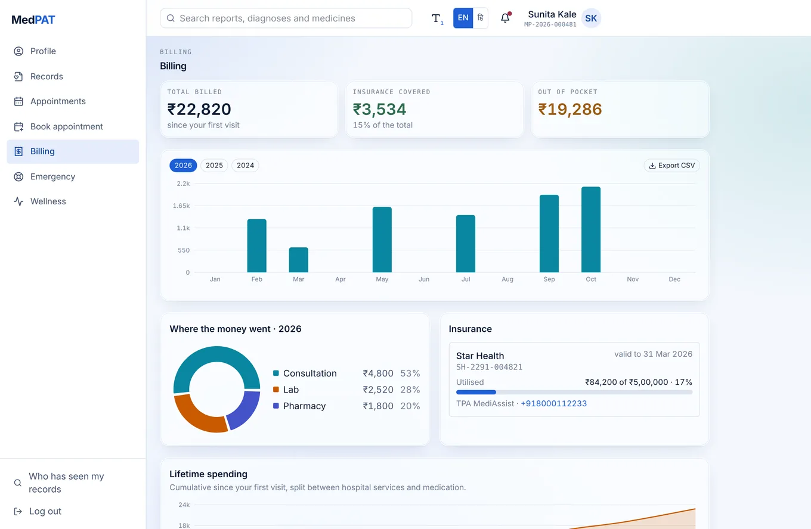
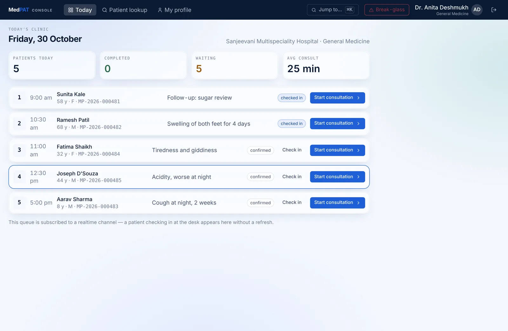
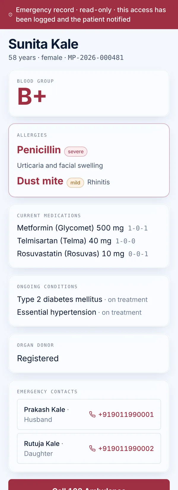
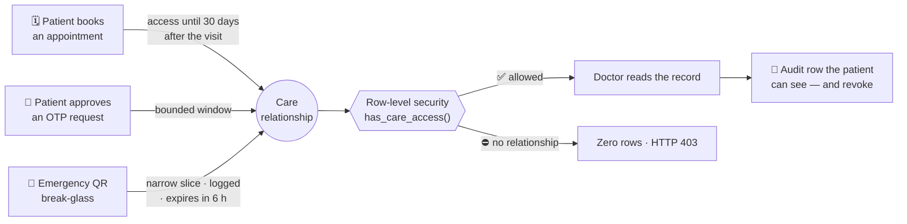
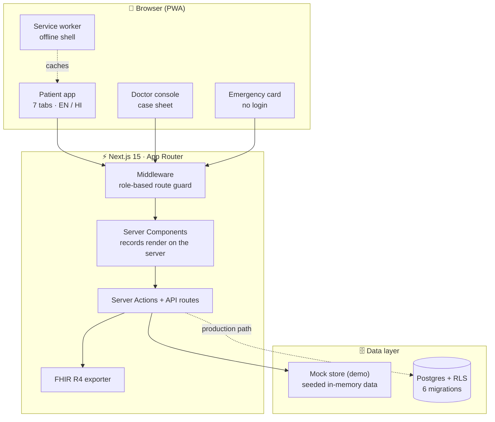

<div align="center">

# 🩺 MedPAT

### Your health record, in your pocket — consented, portable, ABDM-ready.

*A patient arrives at a new hospital with a plastic bag of paper. The doctor starts from zero.*<br>
**MedPAT fixes that.**

[](https://medpat-live.vercel.app)
[](#)


[**Try it**](#-try-it-in-30-seconds) ·
[**Features**](#-what-it-does) ·
[**How consent works**](#-consent-not-access) ·
[**Architecture**](#-architecture) ·
[**Run locally**](#-run-it-locally) ·
[**Team**](#-team)

<br>

<a href="https://medpat-live.vercel.app">
  
</a>

<sub>The doctor's structured case sheet — fourteen sections, autosaved, with allergies and medications pinned beside the form.</sub>

</div>

---

## 💡 The idea in one line

> MedPAT turns the case sheet a doctor already writes on paper into **structured, consented, portable health data** — so the patient carries their history, the next doctor doesn't start from zero, and the record is ABDM-ready from day one.

Most teams read *"case-taking software"* as *"hospital dashboard"* and ship a CRUD app with seven tabs. MedPAT inverts it:

| | |
|---|---|
| 🧾 **System of record** | The doctor's structured case sheet |
| 📱 **Consumer surface** | The patient app — every tab is a read-view over what the case sheet produced |

---

## 🚀 Try it in 30 seconds

No sign-up, no API keys. Open **[medpat-live.vercel.app](https://medpat-live.vercel.app)** → **Open the live demo**, then pick a door:

<table>
<tr>
<th>🧑 Patient — sign in with phone + OTP <code>123456</code></th>
<th>👩‍⚕️ Doctor — email + password <code>demo1234</code></th>
</tr>
<tr valign="top">
<td>

| Phone | Who |
|---|---|
| `+919011220001` | **Sunita Kale** — diabetes + hypertension, richest record, app opens in **Hindi** |
| `+919011220002` | **Ramesh Patil** — CKD stage 3, PM-JAY |
| `+919011220003` | **Aarav Sharma**, 8 — asthma, paediatric vital ranges |
| `+919011220005` | **Joseph D'Souza** |

</td>
<td>

| Email | Use it to |
|---|---|
| `anita.deshmukh@medpat.in` | See today's clinic and open a case sheet |
| `priya.nayak@medpat.in` | Demo the **request-access** flow — she has no patients yet |

**No login at all:** open a public [emergency card →](https://medpat-live.vercel.app/e/EMG-8f2a91c4d7)

</td>
</tr>
</table>

<details>
<summary><b>🎬 Suggested 2-minute demo path</b> (click to expand)</summary>
<br>

1. **Patient** `+919011220001` → notice the app opens in Hindi → switch to English.
2. Open **Records** — one timeline across every hospital. Open a lab report and its trend chart.
3. **Book** an appointment — read the consent sentence before you confirm.
4. Open **Who has seen my records** — every access is logged, with a revoke button.
5. Sign out → **Doctor** `anita.deshmukh@medpat.in` → start a consultation from today's queue.
6. In the case sheet, type a vital out of range (watch it flag), add a diagnosis (ICD-11 autocomplete), try prescribing a drug the patient is allergic to (it **blocks**, not warns).
7. Click **View as FHIR** — that's real FHIR R4 JSON.
8. Sign in as `priya.nayak@medpat.in` → search a patient → padlock. Request access.

</details>

---

## ✨ What it does

<table>
<tr>
<td width="50%" valign="top">

### For patients — seven surfaces, one record

- 🪪 **Profile & health ID card** with an emergency QR
- 📂 **Records** — one vertical timeline across hospitals, full-text search
- 📅 **Appointments** — live queue position, calendar export
- 🗓️ **Booking** — a wizard that can only offer legal slots
- 🧾 **Billing** — spend by category, PM-JAY utilisation, CSV export
- 🚑 **Emergency** — ambulance, location, offline first-aid
- 💚 **Wellness** — a sub-60-second daily check-in

</td>
<td width="50%" valign="top">

### For doctors — the case sheet is the product

- 📋 **Today's clinic** — live queue, one action per row
- 🧠 **Fourteen sections** — OLDCARTS grid, tri-state exam findings
- 🔎 **ICD-11 autocomplete** for diagnoses
- 💊 **Prescription builder** — Indian `1-0-1` notation, allergy conflicts **block**
- 🔒 **Finalise, then amend** — signed sheets are immutable
- 🔁 **FHIR R4 export** of any case sheet

</td>
</tr>
</table>

<details>
<summary><b>📸 More screenshots</b></summary>
<br>

| Patient records | Patient billing |
|---|---|
|  |  |

| Doctor's clinic queue | Public emergency card |
|---|---|
|  |  |

</details>

---

## 🔐 Consent, not access

> *"What stops a doctor reading any patient's file?"*<br>
> **Nothing in the interface. The database refuses.**

A doctor never has access to *patients* — only to **a specific patient, for a bounded window, because a care relationship exists**. That relationship is created by exactly three events:



Enforced in Postgres, not in React:

```sql
create policy "doctor reads with care relationship"
  on case_sheets for select
  using ( has_care_access(patient_id) );

-- nobody deletes a clinical record. Ever.
-- (no DELETE policy = no DELETE permitted)
```

<details>
<summary><b>🧪 How this is verified</b></summary>
<br>

- Against a real **Postgres 16**: a doctor sees exactly her consented patients, a doctor with no relationship sees zero rows, a patient sees only their own.
- The `btree_gist` exclusion constraint rejects a double booking with SQLSTATE `23P01`.
- A finalised case sheet refuses an `UPDATE`.
- The browser smoke test asserts **HTTP 403** on a case sheet outside a doctor's relationships, and **200** inside them.

</details>

---

## 🏗️ Architecture



> **Demo vs production.** The live demo runs on a **seeded mock store** — no real database, no real patient data. It mirrors the SQL exactly: same access rule, same slot generator, same double-booking rejection, same append-only case sheets. The Postgres migrations in `supabase/` are the production path.

<details>
<summary><b>📁 What is where</b></summary>

```
supabase/
  migrations/001_identity.sql      enums, profiles, patients, doctors, hospitals
  migrations/002_scheduling.sql    availability, appointments, available_slots()
  migrations/003_clinical.sql      case_sheets, diagnoses, vitals, investigations
  migrations/004_therapeutics.sql  drug master, prescriptions, history, documents
  migrations/005_ancillary.sql     billing, insurance, wellness, emergency
  migrations/006_governance.sql    care_relationships, consent, audit, RLS
  seed.sql                         3 hospitals · 8 doctors · 5 patients · 42 drugs

src/lib/
  db/seed.ts      the same demo world as seed.sql, same UUIDs
  db/store.ts     the mock store — mirrors the SQL rules
  clinical.ts     vital ranges, ICD-11 offline index, drug-interaction checks
  fhir.ts         case sheet → FHIR R4 document Bundle
  ai.ts           four narrow AI uses, each with an offline fallback
  tz.ts           IST wall-clock vs stored UTC
  i18n.ts         English and Hindi catalogues

src/app/
  page.tsx        public landing page
  start/          the patient / doctor fork
  patient/        profile, records, appointments, book, billing, emergency, wellness
  doctor/         today's queue, patient lookup, case sheet, profile
  e/[token]/      public emergency card
  verify/[token]/ prescription verification for a pharmacist
```

</details>

<details>
<summary><b>🤖 Where AI is used — and where it is not</b></summary>
<br>

Four narrow, assistive uses: a visit summary, a two-year history synthesis, a plain-language report explainer for patients, and symptom structuring before a visit.

Every output is **labelled as generated** and needs **doctor confirmation** before it enters the record. The model never prescribes, never diagnoses, and never triages an emergency — any red-flag symptom routes straight to the emergency screen.

</details>

<details>
<summary><b>🇮🇳 ABDM & standards</b></summary>
<br>

| Standard | How MedPAT uses it |
|---|---|
| **ABHA** | Number and address are first-class fields, with an OTP linking flow |
| **ABDM consent** | Consent artefacts use ABDM's vocabulary — purpose, HI types, date range, expiry |
| **FHIR R4** | Composition, Patient, Encounter, Condition, Observation, MedicationRequest, DiagnosticReport, AllergyIntolerance |
| **ICD-11** | Offline index for diagnosis autocomplete |

**Honest scope:** ABDM alignment is implemented to the M1 shapes against a faithful mock. Full certification (three milestones and a CERT-In audit) is a post-hackathon step.

</details>

---

## 💻 Run it locally

**It runs with zero API keys.** Every integration sits behind a `MOCK_<SERVICE>` flag, and the mock path is the default.

```bash
git clone https://github.com/satvik31-hash/MedPaT.git
cd MedPaT
npm install
npm run dev            # → http://localhost:3000
```

<details>
<summary><b>✅ Checks</b></summary>

```bash
npm run typecheck                  # tsc --noEmit
npm run build && npm start         # production build

npx playwright install chromium    # once
npm run smoke                      # end-to-end browser test of the whole demo path
```

`POST /api/demo/reset` restores an identical clean demo state.

</details>

---

## 👥 Team

<table>
<tr>
<td align="center" width="25%">
<a href="https://github.com/satvik31-hash"><br><b>Satvik Saxena</b></a><br>
<sub>Team lead</sub>
</td>
<td align="center" width="25%">
<a href="https://github.com/Fazal7268"><br><b>Mohd Fazal Abbas Khan</b></a><br>
<sub>Demo database setup</sub>
</td>
<td align="center" width="25%">
<a href="https://github.com/sourajit-ayush"><br><b>Sourajit Kundu</b></a><br>
<sub>Product features</sub>
</td>
<td align="center" width="25%">
<a href="https://github.com/RITHWIK2007-SPEC"><br><b>Rithwik</b></a><br>
<sub>APIs</sub>
</td>
</tr>
</table>

---

<div align="center">

**The record is already written. It just needs to travel.**

[](https://medpat-live.vercel.app)

<sub>Built for the Smart India Hackathon · Patient Case-Taking Software</sub>

</div>
